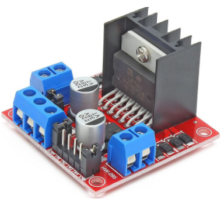
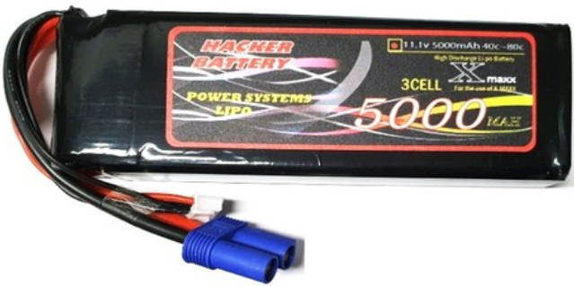
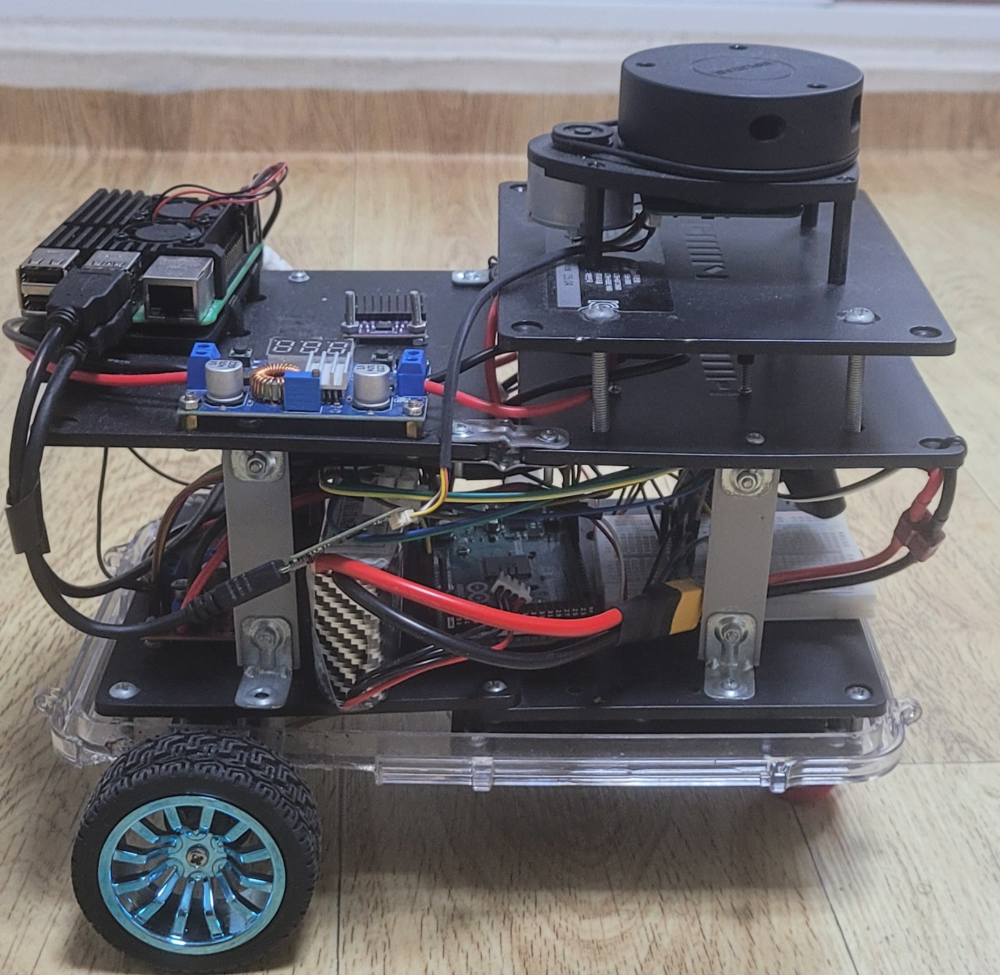
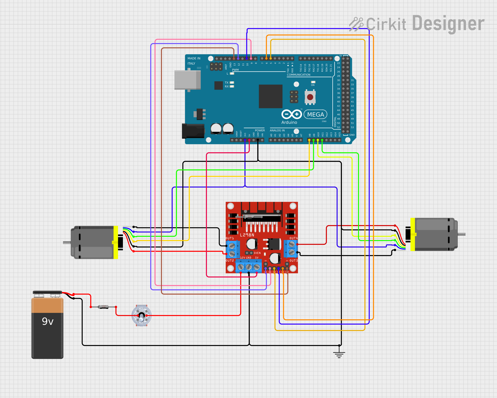
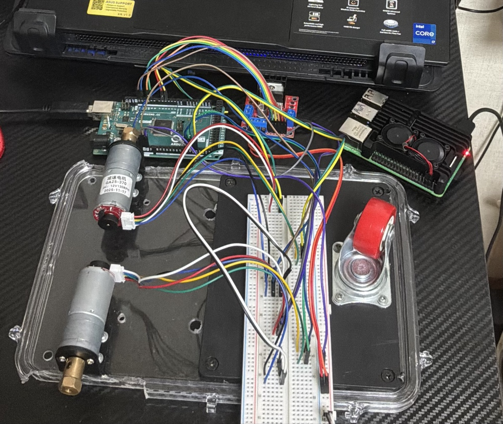
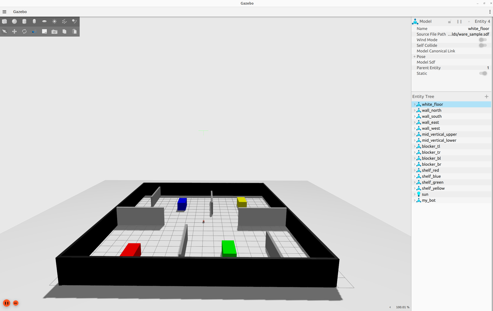
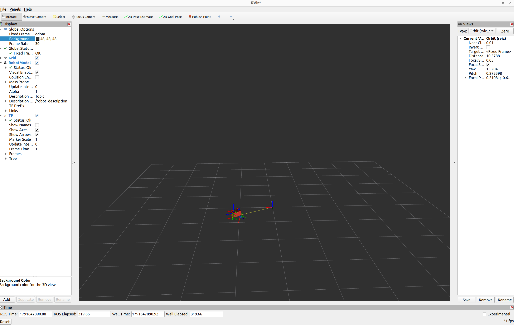
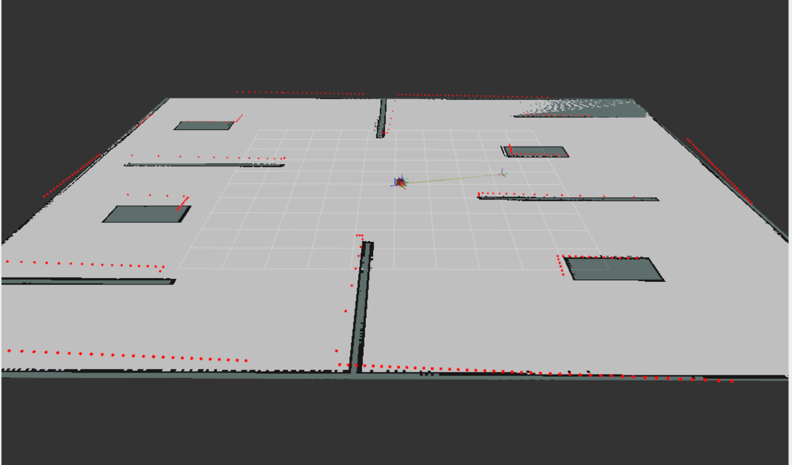
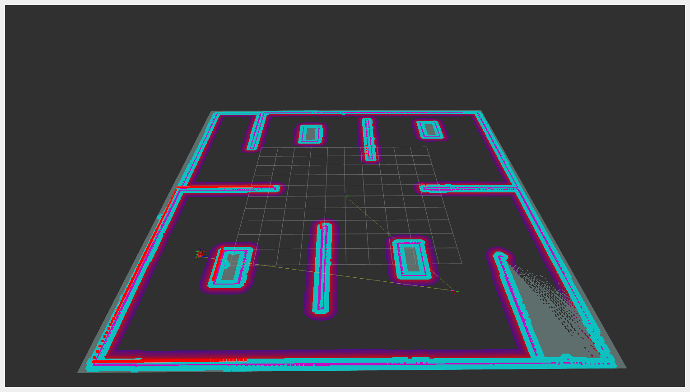

# 2D LiDAR-Based Autonomous Navigation of a Differential Drive Robot

## 📌 Overview

This repository implements autonomous navigation of a differential drive mobile robot using **ROS 2 Humble**. The project leverages a **2D LiDAR (Slamtec RPLIDAR A1)** for simultaneous localization and mapping (SLAM) and **Navigation2 (Nav2)** for path planning, obstacle avoidance, and autonomous navigation. Additionally, it integrates a standard camera and depth camera for visual SLAM and object tracking.
The project is fully validated in both **Gazebo simulation** and on a **real-world hardware platform**. 

---

## Project Features:
- ROS2 Humble-based differential drive robot simulation.
- URDF/Xacro robot description.
- 2D LiDAR integration, Camera and Depth Camera integration.
- SLAM using SLAM Toolbox.
- Autonomous navigation using Navigation2.
- Obstacle avoidance, and object detection.
- Gazebo Fortress simulation.
- Real robot implementation.
  
---

# Hardware Implementation

## 🛠 Hardware Components

|Roll No.|           Component                |                 Image                                                                   |      Description   |
|--------|------------------------------------|-----------------------------------------------------------------------------------------|--------------------|
|    1   | Raspberry Pi 4                     | | Main onboard computer |
|    2   | Arduino Mega 2560                  |  | Low-level motor controller |
|    3   | 2D LiDAR                           |  | Environment perception |
|    4   | L298N Motor Driver                 | | DC motors controls |
|    5   | DC Geared Motors (with encoders)   | | Two 12V 130rpm geared dc motors |
|    6   | Caster Wheel                       |  | Robot support |
|    7   | 3S LiPo Battery                    | | 5000 mAh 11.1v 3S Lipo battery for powering the robot |
|    8   | DC-DC Buck Converter               | | High-power step-down XL4015 5A 75W variable DC converter 5v supply for electronics |
|    9   | Robot Chassis                      |                                                                                         | - |
|    10   |Gamepad controller                  | | Xbox Microsoft 4th generation wireless controller for remote control |

---

## Differential Drive Robot Hardware Platform

<table>
<tr>
<td align="center">
<b></b><br>


</td>

<td align="center">

<video src="https://github.com/user-attachments/assets/5a1af23a-5dcf-43fd-aae2-492f7fd122ab" width="200" height="200" controls></video>
</td>
</tr>
</table>

---
## Arduino mega2560 Pin Configuration

- Clone motor control code from [`ROSArduinoBridge`]( https://github.com/joshnewans/ros_arduino_bridge.git) repository.
- Modify the Interrupt routine encoder reading code (`encoder_drive`) of `ROSArduinoBridge` for Arduino mega2560 since it was written for Arduino Uno:
  
  ```bash
  /* Interrupt routine for LEFT and RIGHT encoder, taking care of actual counting */
  ISR (PCINT2_vect){
  	static uint8_t left_enc_last=0;
    static uint8_t right_enc_last=0;
    uint8_t port_pink = PINK;
    
    // this is for right encoder
	  left_enc_last <<=2; //shift previous state two places
	  left_enc_last |= (port_pink & 0x03); //read the current state
  
    left_enc_pos += ENC_STATES[(left_enc_last & 0x0f)];
  
    // this is for right encoder
    right_enc_last <<=2; //shift previous state two places
    right_enc_last |= (port_pink & 0x0C) >> 2; //read the current state into lowest 2 bits
  
    right_enc_pos += ENC_STATES[(right_enc_last & 0x0f)];
  }
  ```
   and also, modify the `ROSArduinoBridge`:
  
  ```bash
  // Initialize the motor controller if used */
  #ifdef USE_BASE
  #ifdef ARDUINO_ENC_COUNTER
    //set as inputs
    DDRK &= ~(1<<LEFT_ENC_PIN_A);
    DDRK &= ~(1<<LEFT_ENC_PIN_B);
    DDRK &= ~(1<<RIGHT_ENC_PIN_A);
    DDRK &= ~(1<<RIGHT_ENC_PIN_B);
    
    //enable pull up resistors
    PORTK |= (1<<LEFT_ENC_PIN_A);
    PORTK |= (1<<LEFT_ENC_PIN_B);
    PORTK |= (1<<RIGHT_ENC_PIN_A);
    PORTK |= (1<<RIGHT_ENC_PIN_B);
    
    // tell pin change mask to listen to left encoder pins
    PCMSK2 |= (1 << LEFT_ENC_PIN_A)|(1 << LEFT_ENC_PIN_B);
    
    // tell pin change mask to listen to right encoder pins
    PCMSK2 |= (1 << RIGHT_ENC_PIN_A)|(1 << RIGHT_ENC_PIN_B);
    
    // enable PCINT1 and PCINT2 interrupt in the general interrupt mask
    PCICR |= (1 << PCIE2);
  #endif
  initMotorController();
  resetPID();
  #endif
  ```
- The modified version for this project can be found [`here`]( https://github.com/eyasuder/ros_arduino_bridge)
- Port K port register pins (which are pin A8 to A15) of Arduino mega2560 are used for interrupt routine.
- The wiring diagram is done as follows: 
  
|           From                                               | To                    |
| ------------------------------------------------------------  | -----------------------|
| Left Motor Positive terminal                                  | OUT2 L298N motor driver|
| Left Motor Encoder negative terminal                          | GND pin Arduino2560    |
| Left Motor Encoder A phase signal feedback                    | pin A8 Arduino mega2560|
| Left Motor Encoder B phase signal feedback                    | Pin A9 Arduino mega2560|
| Left Motor Encoder positive terminal                          | Arduino mega2560 3V     |
| Left Motor negative terminal                                  | OUT1 L298N motor driver|
| Right Motor positive terminal                                 | OUT3 L298N motor driver |
| Right Motor Encoder negative terminal                         |GND pin Arduino2560|
| Right Motor Encoder A phase signal feedback                   | Pin A11 Arduino mega2560|
| Right Motor Encoder B phase signal feedback                   | Pin A10 Arduino mega2560 |
| Right Motor Encoder positive terminal                         | Arduino mega2560 3V|
| Right Motor negative terminal                                 |OUT4 L298N motor driver |
| Left Motor direction (IN1, L298N motor driver)                | Pin D9 Arduino mega2560|
| Left Motor direction (IN2, L298N motor driver)                | Pin D5 Arduino mega2560|
| Left Motor enable   (ENA, L298N motor driver)                 | Pin D12 Arduino mega2560|
| Right Motor direction  (IN3, L298N motor driver)              |Pin D10 Arduino mega2560 |
| Right Motor direction  (IN4, L298N motor driver)              |Pin D6 Arduino mega2560 |
| Right Motor Enable     (ENB, L298N motor driver)              | Pin A13 Arduino mega2560|

---
## Motor Experiment
- Upload `ROSArduinoBridge` to Arduino mega2560.
- Clone `serial motor demo` from https://github.com/joshnewans/serial_motor_demo.
- Run `miniterm` to test both open loop and closed loop control.
- For closed loop control, experimental encoder revolution per count is approximately 1975 for GJA25-375 endoder dc motor.

<table>
<tr>
<td align="center">
<b>Motor Wiring </b><br>

<b></b><br>

</td>

<td align="center">
<b>Motor Testing Demo</b><br>
<video src="https://github.com/user-attachments/assets/19398011-af18-4047-8f3f-b6f6d7177571" width="400" height="300" controls></video>
</td>
</tr>
</table>
---

# 🧠 Software Stack

## Software Requirements

- Ubuntu 22.04
- ROS 2 Humble
- Gazebo Fortress
- RViz2
- Navigation2
- SLAM Toolbox
- Aeduino IDE

---

# ⚙️ Installation

- Install `ROS2 Humble` and `Gazebo fortress` (Gazebo Ignition)
- Clone the repository

```bash
https://github.com/eyasuder/diff_drive_robot.git
```

- Build the workspace

```bash
cd diff_drive

colcon build --symlink-install

source install/setup.bash
```

---

# 🚀 Running the Project

## 1. Launch Gazebo Simulation

```bash
ros2 launch diff_drive_robot sim.launch.py
```

---

## 2. Start SLAM

```bash
ros2 launch diff_drive_robot online_async_launch.py slam_params_file:=./src/diff_drive_robot/config/mapper_params_online_async.yaml use_sim_time:=true
```

---

## 3. Save the Map

```bash
ros2 run nav2_map_server map_saver_cli -f my_map
```
## 4. Launch AMCL (Adaptive Monte Carlo Localization)

```bash
ros2 launch diff_drive_robot localization_launch.py map:=./path/to/saved/map use_sim_time:=true
```
## 5.  Launch Nav2

```bash
ros2 launch diff_drive_robot navigation_launch.py use_sim_time:=true map_subscribe_transient_local:=true
```

---
# Results

## 🗺️ Mapping

<table>
<tr>
<td align="center">
<b>Gazebo and Rviz simulations</b><br>


</td>
  
<td align="center">
<b>Mapping</b><br>
<video src="https://github.com/user-attachments/assets/280327ed-5290-4da8-bb4b-ab88d4bcd8b2" width="200" height="300" controls></video>

</td>
</tr>
</table>


---

## 🧭 Navigation

<table>
<tr>
<td align="center">
<b>Global cost map</b><br>

<video src="https://github.com/user-attachments/assets/5ba1655c-bca6-42cb-9042-bd11ef00e408" width="200" height="200" controls></video>
</td>

<td align="center">
<video src="https://github.com/user-attachments/assets/3962f8b8-645d-402b-b86f-6dca71b6336d" width="200" height="200" controls></video>
<video src="https://github.com/user-attachments/assets/11b53332-b588-49ed-924d-598235bc7554" width="200" height="200" controls></video>
</td>
</tr>
</table>

---

# Real Robot Experiment 
## Mapping using SLAM toolbox
<table>
<tr>
<td align="center">
<video src="https://github.com/user-attachments/assets/c9f206b4-4b04-4274-a6d6-8404f87407d6" width="200" height="300" controls></video>
</td>
	
<td align="center">
<b>Map</b><br>

</td>
</tr>
</table>


---
## Autonomous navigation on real robot using Nav2

<table>
<tr>
<td align="center">
<video src="https://github.com/user-attachments/assets/0adb078e-eddb-4591-8b14-67df9b7cd595" width="200" height="200" controls></video>
</td>

<td align="center">
<video src="https://github.com/user-attachments/assets/7e6ebb20-3414-49c0-9dde-ae4a87fb753e" width="200" height="200" controls></video>
</td>
</tr>
</table>


---

# Repository Structure

```
diff_drive_robot/
	├── config/
	│   ├── controller.yaml
	│   ├── gz_bridge.yaml
	│   ├── joystick.yaml
	│   ├── mapper_params_online_async.yaml
	│   ├── nav2_params.yaml
	│   ├── twist_mux.yaml
	│   └── *.rviz
	│
	├── launch/
	│   ├── sim.launch.py
	│   ├── online_async_launch.py
	│   ├── localization_launch.py
	│   ├── navigation_launch.py
	│   ├── rplidar.launch.py
	│   └── joystick_controller.launch.py
	│
	├── robot_urdf_description/
	│   ├── robot_main_urdf.xacro
	│   ├── robot_description.xacro
	│   ├── ros2_control.xacro
	│   ├── gazebo_control.xacro
	│   ├── wheel_macro.xacro
	│   ├── lidar_sensor.xacro
	│   ├── camera_sensor.xacro
	│   ├── depth_camera.xacro
	│   └── inertia.xacro
	│
	├── worlds/
	│   ├── warehouse_world.sdf
	│   ├── ware_sample.sdf
	│   ├── ware1_sample.sdf
	│   ├── demo_world_fortress.sdf
	│   └── ...
	│
	├── CMakeLists.txt
	├── package.xml
	└── README.md

```

# Feature works

- Sensor fusion ( Wheel encoder and BNO085 9 axis IMU for odometry correction).
- Custom Motion planning and controller implementation. 
- Computer vision (Object tacking).
- Chassis design using CAD softwares.


---
